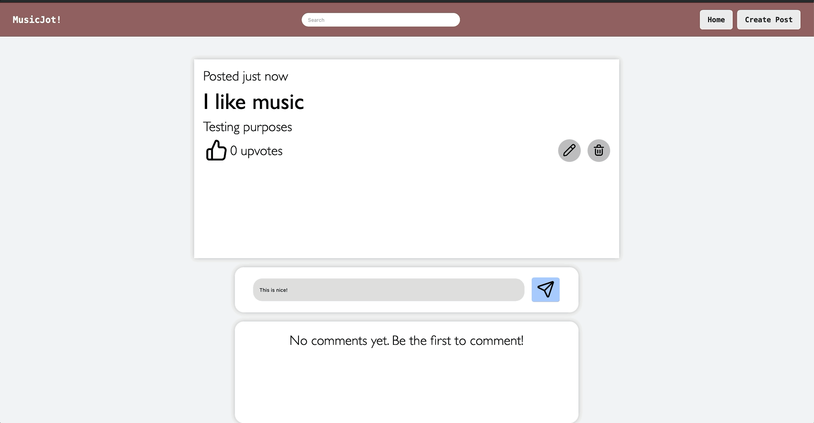

# MusicJot!

**A space to share music-related thoughts, ideas, and conversations.**

MusicJot! is a community-focused web application where users can create posts about music, explore discussions, leave comments, and upvote content. Built as a **CodePath WEB102 final project**, it uses React for the interface and Supabase to store and manage posts and comments.

## 🎬 Project Preview



## Features

- **Create posts** with a title, optional description, and optional image URL.
- **Browse a post feed** with titles, upvote counts, and relative posting times.
- **Search posts** by title from the home page's navigation bar.
- **Sort posts** by newest, oldest, most popular, or least popular.
- **View post details** including descriptions, images, and comments.
- **Upvote posts** with a short client-side cooldown between votes.
- **Join discussions** by adding comments to individual posts.
- **Edit and delete posts** from their detail pages.
- **Store data with Supabase** so posts and comments persist in a database.

## Tech Stack

| Technology | Purpose |
| --- | --- |
| React | Component-based user interface |
| JavaScript (JSX) | Application logic and components |
| Vite | Development server and build tool |
| React Router | Navigation between pages |
| Supabase | Database access and persistence |
| CSS | Styling and layout |
| Oxlint | Code linting |

## Getting Started

### Prerequisites

- Node.js and npm (use a version compatible with Vite 8)
- A Supabase project with the required database tables and permissions

### 1. Clone the repository

```bash
git clone https://github.com/SamM-SWE/MusicJot.git
cd MusicJot
```

### 2. Install dependencies

```bash
npm install
```

### 3. Configure environment variables

Create a `.env` file in the project's root directory:

```env
VITE_SUPABASE_URL=your_supabase_project_url
VITE_SUPABASE_PUBLISHABLE_KEY=your_supabase_publishable_key
```

You can find these values in your Supabase project's settings. **Do not commit your `.env` file or any secret/service-role keys.** The publishable key is intended for client-side use, so ensure your Supabase tables are protected with appropriate Row Level Security policies.

### 4. Start the development server

```bash
npm run dev
```

Open the local URL displayed in your terminal (typically `http://localhost:5173`).

## 🗃️ Supabase Setup

The application expects the following database resources:

- **`Posts`** table with fields used by the app: `id`, `created_at`, `title`, `desc`, `imgUrl`, and `upVotes`.
- **`Comments`** table with fields used by the app: `id`, `created_at`, `postId`, and `comment`.
- **`upvote_post`** database function (RPC), called with a `p_post_id` argument to update a post's upvote count and return the new count.

Configure suitable column types, defaults, relationships, and access policies in Supabase. The repository does not currently include a database migration or SQL setup script, so this database configuration must be provided separately.

## 📁 Application Routes

| Route | Description |
| --- | --- |
| `/` | Home feed, search, and sorting |
| `/CreatePost` | Create a new post |
| `/posts/:id` | View a post, upvote, and comment |
| `/post/edit/:id` | Edit an existing post |

## Available Commands

```bash
npm run dev       # Run the development server
npm run build     # Create a production build
npm run preview   # Preview the production build locally
npm run lint      # Run Oxlint
```

## 🎓 About the Project

MusicJot! was developed for **CodePath WEB102** as a final project. It demonstrates React components and state management, client-side routing, form handling, database CRUD operations, asynchronous data fetching, and integration with Supabase.

## Developer

**Samuel Monneh**  
GitHub: [@SamM-SWE](https://github.com/SamM-SWE)

---

*Built with React, Vite, and Supabase.*
